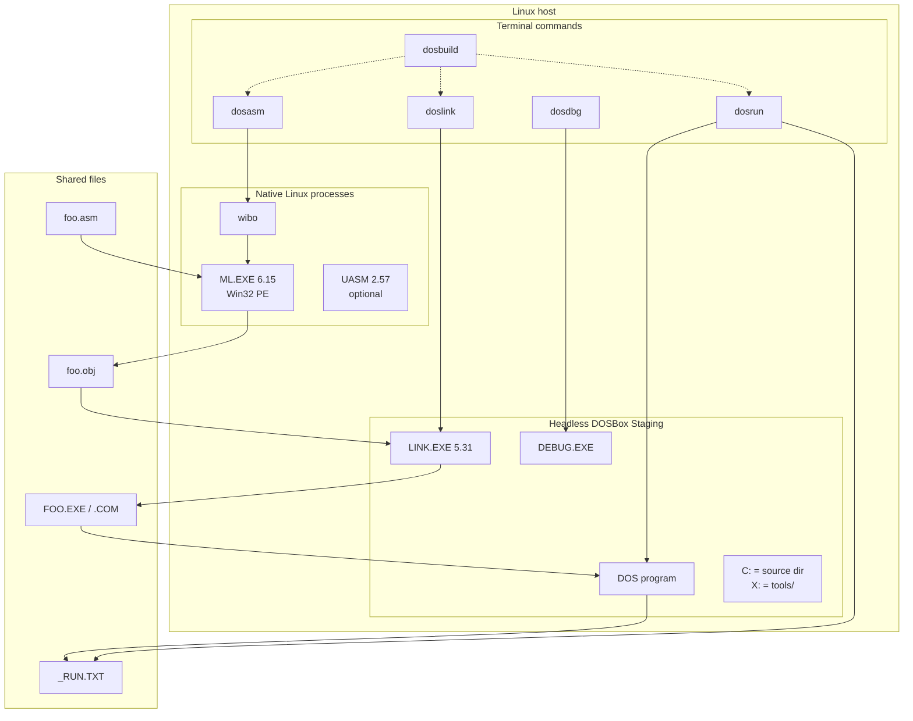

# MASM 6.15 on Linux

**Terminal toolchain for 16-bit DOS assembly — build, link, run, and debug from a Linux shell.**

[中文说明](#中文说明) · [Tutorial](docs/tutorial.md) · [Architecture](docs/architecture.md) · [Troubleshooting](docs/troubleshooting.md)

---

## English Quick Start

This toolchain runs the real **MASM 6.15** `ML.EXE` natively on Linux with
[wibo](https://github.com/decompals/wibo), then uses headless **DOSBox Staging**
only for `LINK.EXE`, `DEBUG.EXE`, and the 16-bit DOS program.

```bash
git clone https://github.com/YSUTKC/masm615-linux.git
cd masm615-linux

./scripts/fetch-tools.sh

# Place your legally licensed files here:
#   tools/masm615/ML.EXE
#   tools/masm615/ML.ERR
#   tools/masm615/LINK.EXE
#   tools/dos/DEBUG.EXE

./scripts/check-env.sh
./scripts/setup.sh

dosbuild -r examples/hello.asm
```

Requirements: Linux x86_64, DOSBox Staging, `bash`/`curl`/`git`, and a
licensed MASM 6.15 + LINK 5.31 + DOS DEBUG. **No Microsoft binaries are
included in this repository.**

---

## 中文说明

在 Linux 终端里完成 16 位 DOS 汇编的完整流程：

```text
dosasm  ->  wibo -> MASM 6.15 ML.EXE  ->  foo.obj
doslink ->  无窗口 DOSBox -> LINK 5.31  ->  FOO.EXE / .COM
dosrun  ->  无窗口 DOSBox -> DOS 程序   ->  _RUN.TXT -> 终端
dosdbg  ->  无窗口 DOSBox -> DEBUG.EXE  ->  单步/寄存器/内存
```

MASM 6.15 的 `ML.EXE` 是 **Win32 PE**，DOSBox 不能直接运行；本方案用
wibo 在 Linux 上原生加载它。`LINK.EXE`、`DEBUG.EXE` 和你的教材程序是
**16 位实模式 DOS 程序**，所以仍然在 DOSBox 中运行。

### 架构



更详细的说明见 [docs/architecture.md](docs/architecture.md)。

### 特性

- 真正运行 **MASM 6.15**，不是语法兼容替代品；`ML.EXE` 版本 6.15.8803。
- 汇编阶段完全在 Linux 原生执行，速度接近普通编译器，不需要 Wine。
- `LINK.EXE` 5.31、`DEBUG.EXE` 和 DOS 程序在无窗口 DOSBox 中执行。
- 终端捕获 DOS 标准输出；图形/键盘程序可切到 DOSBox 窗口。
- `dosdbg -i` 是持久 FIFO 会话，支持 `r/u/d/t/p/g` 等 DEBUG 命令。
- 超时看门狗处理 snap 版 DOSBox 的 AppArmor 限制，不残留进程。
- 支持 UASM 作为原生备用汇编器（`dosasm --uasm`）。
- 附带 7 个可运行的示例程序。

### 依赖

- Linux x86_64（wibo 是 x86_64 ELF）。
- `bash`、`git`、`curl`、`timeout`、`find`、`sed`、`awk`、`pkill`、
  `sha256sum`。
- **DOSBox Staging**：`sudo snap install dosbox-staging`，或确保
  `dosbox-staging` 在 `PATH` 中；也可以用 `DOSBOX=/path/to/dosbox-staging`
  指定。
- 合法授权的 **MASM 6.15**：`ML.EXE`、`ML.ERR`、`LINK.EXE`、
  `LIB.EXE`（可选）。
- DOS **`DEBUG.EXE`**（MS-DOS DEBUG 或 FreeDOS DEBUG）。

> 本仓库**不包含** Microsoft MASM/LINK/DEBUG 二进制，也不会自动下载它们。
> 请使用你已获授权的副本。详见 [NOTICE.md](NOTICE.md)。

### 安装

```bash
git clone https://github.com/YSUTKC/masm615-linux.git
cd masm615-linux

# 1) 下载 wibo 和可选的 UASM（带 SHA-256 校验）
./scripts/fetch-tools.sh

# 2) 放入你自己的 Microsoft 工具
#    tools/masm615/ML.EXE
#    tools/masm615/ML.ERR
#    tools/masm615/LINK.EXE
#    tools/masm615/LIB.EXE     # 可选
#    tools/dos/DEBUG.EXE

# 3) 检查环境
./scripts/check-env.sh

# 4) 安装 dos* 命令到 ~/.local/bin
./scripts/setup.sh
```

如果 `~/.local/bin` 不在 `PATH` 中：

```bash
export PATH="$HOME/.local/bin:$PATH"
```

把这一行加到 `~/.bashrc` 或 `~/.zshrc` 可持久生效。

### 快速开始

```bash
dosbuild -r examples/hello.asm
```

输出：

```text
Hello DOS!
```

分步执行：

```bash
dosasm examples/hello.asm      # -> hello.obj
doslink examples/hello.obj     # -> HELLO.EXE
dosrun examples/HELLO.EXE      # -> Hello DOS!
```

### 命令

| 命令 | 作用 | 示例 |
|------|------|------|
| `dosasm` | 用 MASM 6.15 汇编 | `dosasm -l test.asm` |
| `doslink` | 用 LINK 5.31 连接 | `doslink test.obj` |
| `dosrun` | 在 DOSBox 中运行并捕获 stdout | `dosrun test.exe` |
| `dosdbg` | 用 DEBUG 调试 | `dosdbg -i test.exe` |
| `dosbuild` | 汇编 + 连接（可运行） | `dosbuild -r count.asm` |

常用选项：

```bash
dosasm -l count.asm            # 生成 count.lst（含机器码）
dosasm --uasm test.asm         # 改用 UASM
doslink -c tiny.obj            # 生成 .COM（LINK /TINY）
doslink -m test.obj            # 生成 .MAP
dosrun -t 5 game.exe           # 5 秒超时
printf 'A' | dosrun examples/READCH.EXE # 管道输入
dosrun --gui game.exe          # 打开 DOSBox 窗口
dosdbg test.exe r u q          # 脚本化 DEBUG
dosdbg -i test.exe             # 交互式 DEBUG
dosdbg --gui test.exe          # 原生 DEBUG 窗口
```

### 示例

`examples/` 下有 7 个程序，全部可以直接运行：

| 文件 | 内容 | 知识点 |
|------|------|--------|
| `hello.asm` | Hello DOS | 最小 MASM 6.x 程序 |
| `sort.asm` | 冒泡排序 | 数组、嵌套循环、有符号比较 |
| `prime.asm` | 100 以内素数筛 | 字节数组、`MUL`、下标寻址 |
| `fact.asm` | 递归阶乘（32 位） | `.386`、32 位乘除、递归 |
| `matrix.asm` | 2×2 矩阵乘法 | 二维数组、三层循环、`IMUL` |
| `hanoi.asm` | 递归汉诺塔 | 递归、栈保存现场 |
| `readch.asm` | 读取并回显一个字符 | `INT 21h` 输入、管道输入 |

```bash
dosbuild -r examples/sort.asm
dosbuild -r examples/prime.asm
dosbuild -r examples/fact.asm
dosbuild -r examples/matrix.asm
dosbuild -r examples/hanoi.asm
dosbuild -r examples/readch.asm
```

输出示例和更多说明见 [examples/README.md](examples/README.md)。

### 调试

```bash
dosdbg -i examples/SORT.EXE
```

```text
(dbg) r
(dbg) u
(dbg) t 3
(dbg) g
(dbg) q
```

`-i` 通过 FIFO 把命令送进同一个 DOSBox 会话，是真正的单步调试，不是重放。
`--gui` 会打开 DOSBox 窗口，进入原生 DEBUG 界面。

### 第 6 章：32 位指令

`.386` / `.686` 必须写在 `.model` **之后**：

```asm
.model small
.686
```

否则 `.model` 会把 CPU 重置为 8086，`mov eax, 1` 会被汇编成 16 位操作数。
`dosrun` 使用 `cputype=pentium`，CPUID、BSWAP、486/Pentium 指令可用。
`CMOVcc` 是 Pentium Pro 指令，DOSBox Staging 的 CPU 核心不能正常执行。

### 输出捕获与 GUI

`dosrun` 只能捕获通过 `INT 21h` 写到标准输出的内容。以下程序请用
`--gui`：

- `INT 10h` 显示；
- 直接写 `B800` 显存；
- `INT 16h` 键盘输入；
- 图形/全屏模式。

### 注意事项

1. **DOS 8.3 文件名**：源文件、`.obj`、`.exe`/`.com` 的主名 ≤8，扩展名 ≤3。
   目录名可以长，因为目录是整体挂载为 `C:` 的。封装会检查并提示。
2. **DEBUG 输入必须 CRLF**：封装会自动转换；手写命令文件时注意。
3. **snap 版 DOSBox**：AppArmor 会拒绝外部 `kill`；超时清理由 snap 内部
   发信号，正常返回 `124` 且不残留进程。
4. **MASM/LINK/DEBUG 版权**：仓库不提供这些二进制；请使用合法副本。
5. **CMOV**：DOSBox Staging 不支持；需要时使用 DOSBox-X、真机或 DOS 虚拟机。

更多问题见 [docs/troubleshooting.md](docs/troubleshooting.md)。

### 目录结构

```text
masm615-linux/
├── bin/                     # dosasm / doslink / dosrun / dosdbg / dosbuild
├── docs/                    # 教程、架构、故障排查
├── examples/                # 7 个可运行示例
├── scripts/
│   ├── fetch-tools.sh       # 下载 wibo / UASM 并校验
│   ├── check-env.sh         # 检查环境
│   └── setup.sh             # 安装命令软链
├── tests/smoke.sh           # 端到端冒烟测试
├── tools/                   # 你自备的 MASM/LINK/DEBUG（被 git 忽略）
├── Makefile
├── NOTICE.md
└── LICENSE
```

### 测试

```bash
make check    # 检查环境
make test     # 编译、连接、运行、DEBUG 冒烟测试
make clean    # 清理示例产物
```

### 贡献

欢迎 issue 和 PR。请不要提交 Microsoft MASM/LINK/DEBUG 二进制、许可证密钥
或受版权保护的教材内容。提交前运行 `make test`。

### 许可证

本项目代码、文档和示例使用 [MIT License](LICENSE)。

第三方组件：

- **wibo** — MIT；
- **UASM** — Sybase Open Watcom Public License；
- **DOSBox Staging** — GPL-2.0-or-later。

Microsoft MASM 6.15、LINK、LIB、DEBUG 是微软专有软件，未包含在本仓库中；
请遵守相应许可。详见 [NOTICE.md](NOTICE.md)。
