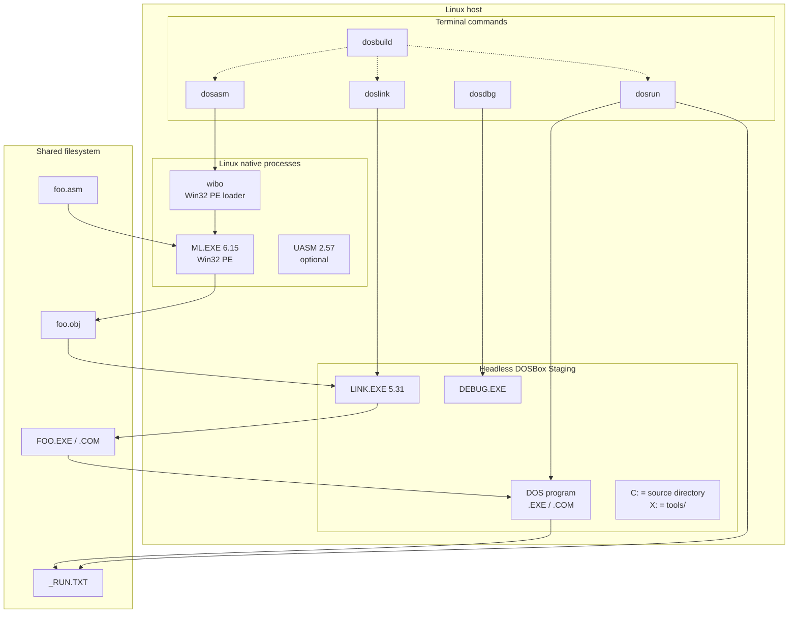

# Architecture

The toolchain deliberately uses **two runtimes**:

1. **Linux native** for assembly, because MASM 6.15's `ML.EXE` is a 32-bit
   Windows PE and cannot run inside DOSBox.
2. **DOSBox Staging** for LINK, DEBUG, and the 16-bit DOS programs, because
   those are real-mode DOS programs that need DOS/BIOS services.



## Compile: `dosasm`

```text
dosasm foo.asm
  -> wibo (Linux process)
  -> ML.EXE 6.15 (Win32 PE, loaded natively)
  -> foo.obj (OMF object)
```

This step does **not** start DOSBox. `wibo` is a small MIT-licensed Win32
loader; it provides enough of the Windows API for `ML.EXE` to read/write files
and print diagnostics.

## Link: `doslink`

```text
doslink foo.obj
  -> headless DOSBox
  -> C: = directory containing foo.obj
  -> X: = tools/
  -> X:\masm615\LINK.EXE foo.obj;
  -> FOO.EXE / .COM
```

`LINK.EXE` 5.31 is a DOS program. The source directory is mounted as `C:` so
relative file references work, and `tools/` is mounted as `X:` so LINK is
reachable even when the source lives in a subdirectory.

## Run: `dosrun`

```text
dosrun foo.exe
  -> headless DOSBox
  -> mount source directory as C:
  -> FOO.EXE > _RUN.TXT
  -> print _RUN.TXT to the terminal
```

Only standard output written through DOS (`INT 21h`) is captured. Programs
using `INT 10h`, direct video memory writes, or `INT 16h` keyboard input
should use `dosrun --gui`.

## Debug: `dosdbg`

```text
dosdbg -i foo.exe
  -> headless DOSBox
  -> DEBUG.EXE foo.exe < FIFO > live output file
  -> wrapper sends commands through the FIFO and prints new output
```

`-i` keeps one DEBUG session alive, so `t`, `p`, `u`, `d`, `g`, etc. behave
like a normal interactive debugger. `--gui` opens the native DOSBox window
instead.

## Why `C:` and `X:`?

- **`C:`** is the directory containing the current source/object/executable.
  This keeps multi-file projects and data files together.
- **`X:`** is the repository's `tools/` directory. It contains `masm615/` and
  `dos/`, so `LINK.EXE` and `DEBUG.EXE` are always available regardless of
  which subdirectory the project is in.

Both tool directory names (`masm615`, `dos`) are 8.3-compatible.

## Constraints that shaped the design

- **8.3 filenames**: DOSBox exposes long names as `~1` aliases; LINK/DEBUG
  would not find the original name. The wrappers check and report this.
- **CRLF for DEBUG input**: DEBUG expects CR-terminated lines; a LF-only
  command script produces `^ Error`. The wrappers convert command files.
- **snap AppArmor**: signals from outside the snap cannot kill a stuck
  DOSBox. The timeout watchdog sends the signal from a shell inside the snap.
- **DOSBox CPU core**: `cputype=pentium` gives working CPUID/BSWAP; CMOV is a
  Pentium Pro instruction and is not executed by DOSBox Staging's core.

See also:

- [README](../README.md)
- [Tutorial](tutorial.md)
- [Troubleshooting](troubleshooting.md)
